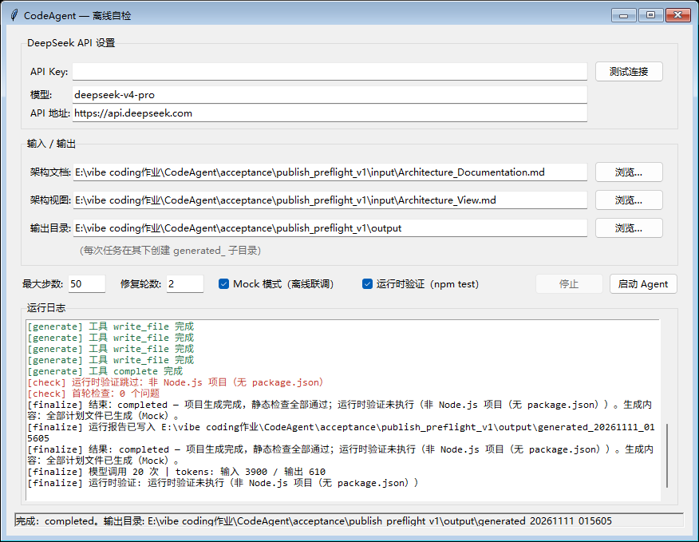

# CodeAgent

根据架构说明和 PlantUML 架构视图生成项目代码的 Windows 桌面智能体。
通过 DeepSeek 官方 API 调用 `deepseek-v4-pro`，支持计划生成、文件工具调用、
结果检查和有限轮次的自动修复，也提供无需 API Key 的离线 Mock 模式。

## Windows 桌面版

从 [Releases 下载 Windows 交付 ZIP](https://github.com/yixianchen612-web/CodeAgent/releases/latest)，
解压后双击 `CodeAgent.exe`。私有仓库的下载需要具有仓库访问权限。
桌面程序的运行依赖已随 exe 打包，使用 Agent 无需预装 Python。

1. 填写自己的 DeepSeek API Key，保留默认模型和官方 API 地址。
2. 选择 `input/Architecture_Documentation.md` 和 `input/Architecture_View.md`。
3. 选择输出目录，点击“启动 Agent”。每次任务会创建独立的 `generated_` 子目录。
4. 完成后打开输出目录，根据生成项目的 README 启动、测试该项目。

离线体验时勾选“Mock 模式”，无需 API Key。Mock 用于验证界面和执行流程，
生成的是固定演示内容。API Key 只在内存或用户自行设置的环境变量中使用，不写入配置文件。

## 从源码运行

开发和重新打包使用 Python 3.12。Agent 运行时仅使用标准库及 Tkinter。
在仓库根目录的 PowerShell 中运行：

```powershell
py -3.12 -m venv .venv
.\.venv\Scripts\python.exe main.py
```

命令行离线生成：

```powershell
.\.venv\Scripts\python.exe -m codeagent --mock --doc input/Architecture_Documentation.md --views input/Architecture_View.md --out generated_project
```

真实生成时在当前进程设置 `DEEPSEEK_API_KEY`，使用同一命令并去掉 `--mock`。
Node.js 项目的自动运行时验证依赖本机 Node/npm，无法执行时会明确记录跳过原因。
生成项目自身可能依赖 Node.js、PostgreSQL 等环境，具体以其 README 为准。

## 测试和构建

```powershell
.\.venv\Scripts\python.exe -m unittest discover -s tests -v
.\.venv\Scripts\python.exe -m pip install -r requirements.txt
.\build_exe.bat
```

构建产物为 `dist/CodeAgent.exe`。源码、输入文件和测试均保存在仓库内部。
当前 Agent 测试为 **141/141 通过**。

验收样例位于 [examples/space-fractions](examples/space-fractions/README.md)，
包含 HTML/JavaScript 前端、Express 后端、PostgreSQL DDL、文档和测试。
其 **27/27 测试通过**；测试使用 Mock，不需要在线数据库。

```powershell
Set-Location examples/space-fractions
npm ci --ignore-scripts
npm test
```

## 离线 exe 验证

构建后，在 PowerShell 中运行：

```powershell
.\acceptance\run_offline_acceptance.ps1
```

脚本只为测试子进程设置 System32 路径，清除其 Python 路径与 API Key，
运行 exe 的显式离线自检入口，通过界面的启动按钮执行 Mock 任务。
结果、日志和截图保存在新建的验收目录中，系统环境变量保持原样。

已完成的本机隔离验证中，外部 `python`、`py`、`node`、`npm` 均不可查找，
exe 仍完成项目生成；其生成项目的 **6/6 测试**在开发机另行通过。
这是本机隔离启动验证，不能等同于在全新 Windows 系统上测试通过。
本次离线验证没有调用真实 API。

详见 [离线验收报告](docs/离线验收报告.md)。



## 实现机制

```text
GUI / CLI
    → 架构预处理与摘要
    → 计划生成与校验
    → LLM 工具调用循环
    → 静态检查与可选运行时测试
    → 最多两轮修复
    → 项目文件与运行报告
```

- `LLMClient` 与 `ToolExecutor` 分离，支持真实客户端与 Mock 客户端。
- 支持相对路径检查、写入大小限制、检查命令形态校验和 `shell=False` 执行。
- 输出包含代码、依赖声明、README、测试，以及计划和运行报告。
- 报告独立记录验证通过、失败、跳过和未执行，完成提示由程序生成。

调研来源及设计记录见 [调研记录](docs/调研记录.md)。
开发阶段的详细历史记录保留在 [开发与验收记录](docs/开发与验收记录.md)。

## 仓库结构

```text
CodeAgent/
├── main.py
├── codeagent/                 # GUI、编排器、模型客户端、工具与检查器
├── input/                     # 两份架构输入
├── examples/space-fractions/   # 当前已验收的生成样例
├── tests/                     # Agent 单元和集成测试
├── docs/                      # 调研与验收记录
├── acceptance/run_offline_acceptance.ps1
├── requirements.txt
├── build_exe.bat
├── CodeAgent.spec
└── Dockerfile
```

构建产物、虚拟环境、依赖目录、API 配置及开发临时文件不纳入 Git。
