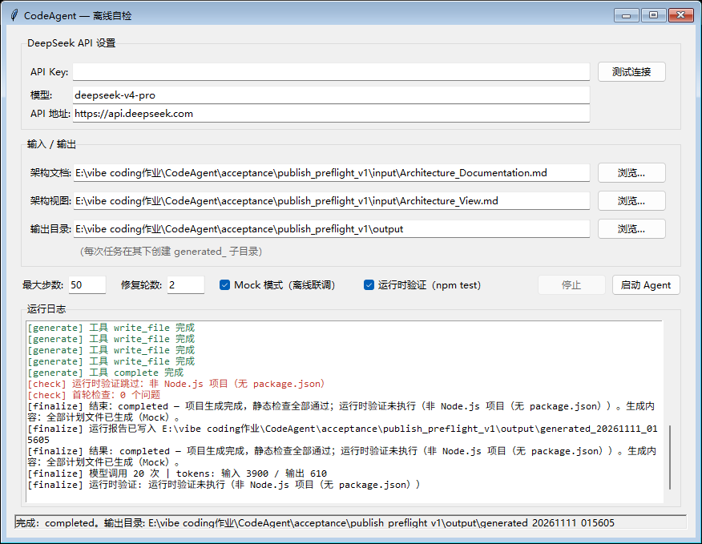

# CodeAgent 离线验收报告

验收时间：2026-11-11（北京时间，v1.0.0 发布前复验）。

| 检查项 | 本次结果 |
| --- | --- |
| Windows 单文件 exe 重新构建 | 通过，日志见 verification/build.log |
| 当前交付 exe 的 GUI Mock 全流程 | 通过，frozen=true，客户端为 MockLLMClient |
| 子进程工具路径 | python、py、node、npm 均不可查找 |
| 项目输出 | 代码、README、依赖声明、测试、计划、运行报告均齐全 |
| 检查状态 | 如实记录运行时验证 skipped，没有声称真实测试已执行 |
| Agent 测试 | 141/141 通过，见 verification/unit_tests.log |
| 当前交付样例测试 | 27/27 通过，见 verification/sample_tests.log |
| exe 生成的 Mock 项目测试 | 6/6 通过，使用开发机解释器另行执行，见对应日志 |
| 真实 API 调用 | 本次未执行，按用户选择仅做离线验证 |
| 全新 Windows 系统验证 | 本次未执行；隔离 PATH 不等于移除电脑中的运行环境 |

exe SHA-256：`62c99240e754ce455f4c50a147e4b8f162559a02b1e9a3549babd0264e4c163f`。

自检自动设置了输入文件路径与 Mock 选项，并调用 GUI 的启动按钮，
经过真实的线程、队列、Agent 编排和界面完成事件。文件选择对话框的人工操作、
真实模型生成质量及全新系统兼容性不在本次自检范围内。
生成过程中的模型调用计数是 Mock 调用计数，不代表付费 API 请求。

